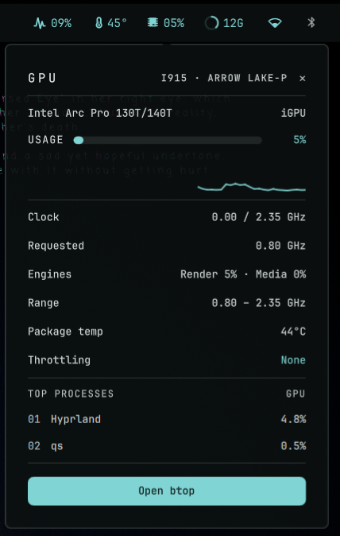

# GPU Monitor

GPU usage on the QS Bar, with a panel of clocks, VRAM, temperature, throttling
and the top GPU processes. Works without root on Intel, AMD and NVIDIA.



## What it does

- **Widget** — a GPU glyph and the current usage % on the QS Bar. A click only
  opens the panel.
- **Panel** — GPU name, a usage bar with a 60-sample history, then whatever the
  GPU reports: clock (current / maximum), requested clock and render/media split
  (Intel), frequency range, VRAM (AMD, NVIDIA), GPU temperature (AMD, NVIDIA) or
  CPU package temperature (Intel), throttling reasons (Intel), the top three
  processes by GPU use, and an Open btop button. Rows a GPU doesn't report are
  hidden.
- **Service** — runs `bin/gpu-stat.sh` every 2 s (every 1 s while the panel is
  open) and turns its snapshot into the values above.

| Driver | Usage from | Status |
| --- | --- | --- |
| `i915` (Intel) | per-process engine time in DRM fdinfo; RC6 residency as fallback | tested |
| `xe` (newer Intel) | fdinfo engine cycles | experimental |
| `amdgpu` (AMD) | `gpu_busy_percent` | experimental |
| `nvidia` (proprietary) | `nvidia-smi`, for the selected GPU only | experimental |

With several GPUs, `auto` prefers NVIDIA, then an AMD card with more than 2 GB of
VRAM (a discrete card), then the integrated GPU. Set **GPU** to a card name
(`card1`), PCI slot or driver to choose one; every reading, NVIDIA included,
follows that choice.

## Install

From this folder on a Ryoku desktop:

```
ryoku plugin validate .
ryoku plugin add . --bar --yes
```

Or install from **Ryostore → Plugins** once it is listed, then enable and place
it under **QS Bar Settings → Community**.

## How it plugs in

- `service/Main.qml` — samples `bin/gpu-stat.sh` and computes usage and the top
  processes.
- `content/Widget.qml` — the bar glyph and usage %; a click calls
  `pluginApi.togglePanel()`.
- `content/Panel.qml` — the GPU panel.
- `bin/gpu-stat.sh` — one read-only snapshot of the selected GPU as `key=value`
  lines.

### What it runs

| Command | When |
| --- | --- |
| `bin/gpu-stat.sh <gpu> [top]` | Every 2 s, every 1 s with the panel open. Uses `awk`, `grep`, `date`, `readlink`, `basename` and `cat` |
| `nvidia-smi --query-gpu=…`; `nvidia-smi pmon -i <index> -c 1` with the panel open | NVIDIA only, from the script, for the selected GPU |
| `lspci -vmm -s <slot>` | Once per GPU, for its name |
| `<terminal> -e btop` | Open btop button |

### What it reads

`/sys/class/drm/card*` (driver, clocks, RC6, throttle reasons, AMD busy and
VRAM), `/sys/class/hwmon/*` (temperatures), and the DRM entries in
`/proc/*/fdinfo/*` of your own processes (Intel always; AMD only with the panel
open) plus `/proc/<pid>/comm` for their names.

### What it never does

- No network access.
- No privileged escalation (`pkexec` / `sudo` / `doas` / `su`).
- No writes anywhere.
- No compositor-specific tools.

## Settings

| key | type | default | description |
| --- | --- | --- | --- |
| gpu | text | auto | Which GPU to show: `auto`, a card (`card1`), PCI slot or driver (`i915`, `xe`, `amdgpu`, `nvidia`) |
| terminal | text | kitty | Terminal used to open btop, run as `<terminal> -e btop` |

## Develop

```
gpu-monitor/
  manifest.json             # id, version, hosts, entry points, files
  service/Main.qml          # sampling and usage maths
  content/Widget.qml        # bar glyph and usage %
  content/Panel.qml         # GPU panel
  bin/gpu-stat.sh           # read-only GPU snapshot
  assets/preview-widget.png # README / Store preview
  LICENSE                   # MIT
```

## Source

[https://github.com/hectorbaez81/gpu-monitor](https://github.com/hectorbaez81/gpu-monitor)

## Maintenance & safety

A community contribution, maintained by its author, not the Ryoku team.

## Credits

Héctor Báez \<hector.baez@gmail.com\>. MIT licensed. See [LICENSE](LICENSE).
